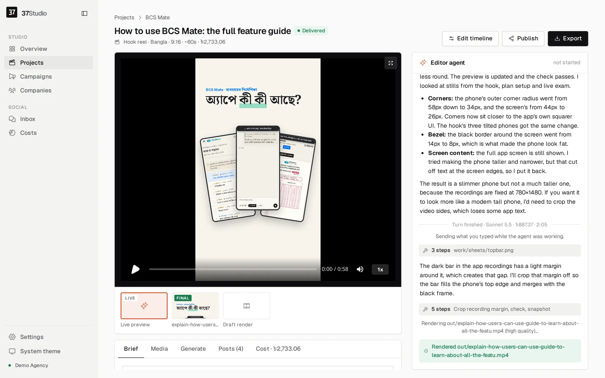

<p align="center"></p>

<h1 align="center">37Studio</h1>

<p align="center"><b>An AI video studio and social media desk that runs on your own computer.</b><br>
Videos made, posted and answered, with your own keys and no monthly bill.</p>

<p align="center">
  <a href="LICENSE"></a>
  <a href="https://studio.shaitrish.com"></a>
  
  
</p>

<p align="center">
  <a href="https://studio.shaitrish.com/#intro"><b>▶ Watch the intro video</b></a> ·
  <a href="https://studio.shaitrish.com/setup">Setup guide</a> ·
  <a href="https://github.com/Shaitrish/37studio/issues">Issues</a> ·
  <a href="https://studio.shaitrish.com/donate">Donate</a>
</p>

[](https://studio.shaitrish.com/#intro)



37Studio makes videos for a business and runs its social accounts, from one app on your own computer. Add a brand from its website and it builds a brand library and a knowledge base. Brief a video and Claude Code, the editor agent, builds it as a [HyperFrames](https://github.com/heygen-com/hyperframes) composition in that brand, checks its own frames and renders it on your machine. Publish it to the brand's accounts with a caption written for each platform, now, on a schedule or on Autopilot. Messages and comments land in one inbox with replies drafted from the knowledge base.

You bring your own keys (a Claude plan or an Anthropic API key; optionally OpenAI, xAI, OpenRouter or OpenCode for other agent models, Gemini or fal.ai for images and video, ElevenLabs for voice) and pay the providers directly. Every project shows what it cost in AI usage, in USD by default. 37Studio is free and open source under the MIT License, made by [Shaitrish](https://shaitrish.com), a software team in Dhaka.

## What it does

- **Brand library from a website or folder.** Paste a URL, or pick the brand's own project folder, and get its logos, people, photos, fonts and exact colours sorted and captioned, plus a design system (`design.md`) and a knowledge base (`knowledge.md`).
- **An editor agent.** Claude Opus 5.5 builds each video as an animated HyperFrames composition, checks its own frames and takes changes in plain words. Edit by hand on a real timeline when you want to.
- **Many kinds of output.** Hook reels, captioned clips, motion-graphics explainers, podcast clips, promo ads, square and portrait posts, and thumbnails. Save any finished video as a template for the next one.
- **Long recordings into many videos.** A 2-hour class becomes ten reels. Transcription runs locally with faster-whisper: free, private, about 100 languages. YouTube and Google Drive links import directly.
- **Generated media.** Gemini images; video clips from Gemini or, through fal.ai, Seedance, Kling, Veo, Wan and others; ElevenLabs voiceover, sound effects and music. The agent asks before media on one project costs more than the limit in Settings → Spending, and keeps a person or product consistent by reusing one reference image across shots. The agent uses them only when the footage and brand library can't do the job, and says what it made.
- **Publishing and Autopilot.** Post to any mix of a brand's accounts on nine platforms now or on a schedule, or let a content plan make a fresh video before every slot and wait for one-click approval.
- **One inbox.** Messenger, Instagram and WhatsApp messages and Facebook and Instagram comments, with replies drafted in the customer's language, following the brand's own rules. Off, drafts to approve, or fully automatic, per brand.
- **Assistant and MCP.** Run everything by chatting with the Assistant in the sidebar, or from your own AI agent (Claude Code, Claude Desktop, Cursor) through 37Studio's MCP server: brands, campaigns, videos, publishing, Autopilot, settings and connections.
- **Real costs.** Every project, campaign and brand shows its AI spend in your currency. No markup: you pay Anthropic, Google and ElevenLabs directly.

Everything runs in one Docker container, on your computer or your own server. Footage, brands and messages stay there; API keys and platform credentials are encrypted on disk.

## Platforms

| Platform | Publishes | Inbox | You connect with |
| --- | --- | --- | --- |
| Facebook Pages | Reels and Page videos | Messenger, comments | Facebook Login through your own Meta app |
| Instagram (Business or Creator) | Reels | Messages, comments | The same sign-in as Facebook |
| YouTube | Videos | | Your own Google OAuth client |
| TikTok | Videos, or to the creator's drafts | | Your own TikTok app |
| LinkedIn | Videos to your profile; company Pages with LinkedIn's approval | | Your own LinkedIn app |
| X | Video posts | | Your own X app |
| Pinterest | Video Pins, on the boards you pick | | Your own Pinterest app |
| Bluesky | Video posts | | Handle and an app password |
| Mastodon | Video posts | | Server URL and an access token |
| WhatsApp | | Messages | A WhatsApp Business API number and a Cloudflare Tunnel to your copy (or your own relay) |

Not possible: **Threads** (its API only takes a video from a public URL, which a local-first app doesn't have), **Facebook Groups and personal profiles** (Meta removed it), **Reddit and Snapchat** (no usable public video-posting API). Setup for each platform: [Social publishing](#social-publishing).

## Quick start

You need [Docker Desktop](https://www.docker.com/products/docker-desktop/) (Windows 10 or 11 with WSL 2, macOS on Intel or Apple Silicon) or Docker Engine (Linux), 16 GB of RAM and about 20 GB of free disk, plus a Claude plan or an Anthropic API key.

### On your computer: the ready-made app

1. Install Docker Desktop and open it once.
2. Download [37studio.zip](https://studio.shaitrish.com/37studio.zip) and unzip it into a folder you'll keep, for example `Documents/37Studio`.
3. Double-click `start.bat` (Windows) or `start.command` (Mac; the first time, right-click → Open), or run `./start.sh` (Linux).

The launcher starts Docker, pulls the latest image (about 3 GB the first time) and opens the app at http://localhost:8080, which only accepts connections from your own computer. Every later start checks for updates first. Your work lives in the `data` folder next to the launcher; back it up. The [setup guide](https://studio.shaitrish.com/setup) walks through every step for Windows, Mac and Linux.

### From source

```bash
git clone https://github.com/Shaitrish/37studio.git && cd 37studio
cp .env.example .env      # optional: keys can also be added later in Settings → Keys
docker compose up --build
# open http://localhost:8080
```

- **Agent permissions.** From source, the agent uses an allowlist (`safe`: file edits, ffmpeg, `npx hyperframes`, `37studio` and a few shell basics) unless you set `STUDIO37_AGENT_PERMISSIONS=bypass` in `.env`, which lets it run any command inside the container. The launcher and the cloud file set `bypass`, because the container is the sandbox. `safe` keeps the agent from running arbitrary code by accident, but it is not a security boundary: the agent can read the AI keys in its environment and the files in `/data`, and ffmpeg and WebFetch can reach the internet. The allowlist covers Claude Code runs; OpenCode runs follow OpenCode's own permission settings.
- **Windows.** Use Docker Desktop with the WSL 2 backend. Footage under `./data` is a bind mount, so for multi-GB files keep the repo inside the WSL filesystem (`\\wsl$\...`) rather than on `C:\`.

To work on the code with hot reload, see [CONTRIBUTING.md](CONTRIBUTING.md#running-it-from-source).

### Run it in the cloud

Run it on a server when a team shares it, or when Autopilot and auto-replies should keep going while your laptop sleeps. [`docker-compose.cloud.yml`](docker-compose.cloud.yml) runs the app behind [Caddy](https://caddyserver.com), which gets and renews an HTTPS certificate for your domain by itself.

**Server.** A Linux VPS with 16 GB of RAM (recommended) and 4 or more vCPUs: rendering and transcription run on the CPU, so more cores make them faster. Give it 50 GB or more of disk for the image, footage and renders. Both amd64 and arm64 servers work.

1. Point a DNS **A** record (and **AAAA**, if the server has IPv6) for your domain, for example `studio.example.com`, at the server.
2. Install Docker: `curl -fsSL https://get.docker.com | sh`.
3. Open TCP ports **80**, **443** and **3100–3109** in the server's firewall (and in your cloud provider's firewall, if it has one).
4. Get the compose file and create `.env` next to it:

   ```bash
   mkdir 37studio && cd 37studio
   curl -fsSLO https://raw.githubusercontent.com/Shaitrish/37studio/main/docker-compose.cloud.yml
   printf 'STUDIO37_DOMAIN=studio.example.com\nSTUDIO37_PASSWORD=%s\n' "$(openssl rand -base64 24)" > .env
   cat .env                                  # note the password
   mkdir -p data && sudo chown 1000:1000 data  # the app runs as uid 1000 and writes here
   docker compose -f docker-compose.cloud.yml up -d
   ```

5. Open `https://studio.example.com` and sign in with any username and the password. Add your Claude key in **Settings → Keys** (for a subscription token, run `docker compose -f docker-compose.cloud.yml exec studio claude setup-token`).

What is different on a server:

- **Password.** The cloud file won't start without `STUDIO37_PASSWORD`. It is HTTP basic auth on every page, API call and timeline editor, over HTTPS. Use a long random one and share it only with people you trust with the agent (next point).
- **Agent permissions.** The cloud file sets `STUDIO37_AGENT_PERMISSIONS=bypass`, like the launcher: the agent can run any command inside the container. Anyone who can sign in can therefore have it run commands there, read every brand's files in `/data`, and reach the internet. The container runs as an unprivileged user (uid 1000) with no access to the Docker socket or the host's files beyond `./data`. For the allowlist instead, change that line to `safe` in the compose file; commands outside the allowlist are then refused, which can block some tasks. It narrows what the agent runs, but whoever can sign in can still steer the agent, so treat the password as access to everything in the container either way.
- **Sign-in redirects.** The cloud file sets `STUDIO37_PUBLIC_URL=https://<your domain>`, so register `https://<your domain>/api/oauth/<platform>/callback` with each platform. Use the **Web** platform for TikTok.
- **Timeline editor.** The UI opens each project's editor at the page's own address on a port from 3100 to 3109 (`https://studio.example.com:3100`, ...). Caddy serves HTTPS on those ports with the same certificate and passes each one to the same port on the app, so the editor works once the ports are open. Your browser asks for the password once more the first time, because a different port counts as a different site. Up to ten editors can be open at once. If you'd rather not open those ports, everything else still works; make changes by chatting with the agent.
- **Updates.** The sidebar says when a new version is out. Then: `docker compose -f docker-compose.cloud.yml pull && docker compose -f docker-compose.cloud.yml up -d`.
- **Backups.** Everything lives in `./data`: the database, `secret.key` (which decrypts the keys in it), brand files, footage and videos. The database is SQLite in WAL mode, so copy it while the app is stopped, or snapshot the whole disk:

  ```bash
  docker compose -f docker-compose.cloud.yml stop studio
  tar czf 37studio-$(date +%F).tgz data
  docker compose -f docker-compose.cloud.yml start studio
  ```

  The archive holds platform tokens and keys, so store it somewhere private. Agent chat sessions live in the `claude-home` volume; they are only needed to resume old chats.

The launcher and the cloud file use the `latest` image, so a restart can update the app. To stay on a release until you choose to update, replace `latest` with its version (`ghcr.io/shaitrish/37studio:0.5.0`) or its digest.

To build the image from your own checkout on the server, clone the repo and replace the `image:` line in `docker-compose.cloud.yml` with `build: .`.

## First steps

1. **Add keys.** Settings → Keys: an Anthropic API key, or a Claude subscription token (run `docker compose exec studio claude setup-token` in the launcher's folder; from source the service is `37studio`). Gemini and ElevenLabs are optional. Keys are encrypted at rest and sent only to the provider they belong to. Anthropic's terms govern using a Claude subscription in other apps; an API key is the fully supported route.
2. **Add a brand.** Brands → **Add from website or folder**. In 5 to 10 minutes the brand library, design system and knowledge base are ready. Read the **Knowledge** tab and fix anything wrong: every video and reply uses it.
3. **Make a video.** **New project** asks a few questions: what to make, the language, where it runs, how long, what it's about, and optional footage or a YouTube or Drive link. The agent narrates as it works. Ask for changes in the chat, or click **Edit timeline** to change things by hand, then **Export**.
4. **Connect accounts.** On the brand's **Social** tab, click **Connect** for each platform. Most platforms need a developer app of your own first: see [Social publishing](#social-publishing).
5. **Publish.** On the project, **Publish** → pick accounts → **Write with AI** for the captions (or write your own) → post now or schedule it. The **Posts** tab shows each upload's status and a link to the live post.
6. **Autopilot and the inbox.** On the brand's **Autopilot** tab, write a content plan ("3 reels a week with one product tip each, 8 pm, to our Page and Instagram"). Each video is made three hours before its slot and waits for your approval, or posts on its own if you allow it. On the **Social** tab, choose how inbox replies go out and write the brand's reply rules; the **Inbox** in the sidebar has every message and comment.

Autopilot, scheduled posts and auto-replies work while 37Studio runs. Keep the computer awake, or run it in the cloud.

## Social publishing

Each brand's **Social** tab connects its accounts: sign in once per platform, then tick which of the returned accounts belong to that brand. **Publish** sends one final video to any mix of them, now or at a scheduled time. Claude writes a caption for each platform (X and Bluesky stay short, LinkedIn professional, YouTube and Pinterest get a title and description), and you can edit every one. Scheduled posts go out only while 37Studio is running; a post more than 12 hours overdue is marked missed instead of going out late.

Every OAuth platform needs a developer app, and that is your own (free) app: 37Studio has no built-in one. Put its credentials in **Settings → Keys** (encrypted at rest; the only way in the launcher, which has no `.env`), or in `.env` when running from source. Register the redirect URI with the platform: `STUDIO37_PUBLIC_URL` (default `http://localhost:8080`) followed by the path below.

| Platform | Connect button | Credentials | Redirect path |
| --- | --- | --- | --- |
| Facebook Pages + Instagram | Connect Facebook & Instagram | `META_APP_ID`, `META_APP_SECRET`, `META_CONFIG_ID` | `/api/oauth/meta/callback` |
| YouTube | Connect YouTube | `GOOGLE_CLIENT_ID`, `GOOGLE_CLIENT_SECRET` | `/api/oauth/google/callback` |
| TikTok | Connect TikTok (OAuth with PKCE) | `TIKTOK_CLIENT_KEY`, `TIKTOK_CLIENT_SECRET` | `/api/oauth/tiktok/callback` |
| LinkedIn | Connect LinkedIn | `LINKEDIN_CLIENT_ID`, `LINKEDIN_CLIENT_SECRET` | `/api/oauth/linkedin/callback` |
| X | Connect X (OAuth 2.0 with PKCE) | `X_CLIENT_ID`, `X_CLIENT_SECRET` | `/api/oauth/x/callback` (on your computer: `http://127.0.0.1:8080/…`, since X refuses `localhost`) |
| Pinterest | Connect Pinterest, then pick boards | `PINTEREST_APP_ID`, `PINTEREST_APP_SECRET` | `/api/oauth/pinterest/callback` |
| Bluesky | Connect Bluesky: handle + app password | none | |
| Mastodon | Connect Mastodon: server URL + access token | none | |

**[docs/platforms.md](docs/platforms.md) has the step-by-step setup for each one**, also on the website in plain words as [Connect your social accounts](https://studio.shaitrish.com/connect), with a [plain-text copy](https://studio.shaitrish.com/connect.txt) to paste into ChatGPT or Claude so it walks you through. The short version:

- **Facebook + Instagram.** A Meta Business app with Facebook Login for Business, left in Development mode with your team as app roles: no App Review needed. Brand → Social → **Set up your Meta app** walks through it, about 15 minutes. Messenger and Instagram messages from the public need Meta's App Review of your app. Instagram must be a Business or Creator account linked to the Page. Vertical videos of 3–90 seconds post as Reels.
- **YouTube.** A Google Cloud project with YouTube Data API v3 and a *Web application* OAuth client, consent screen set to *In production*. Uploads stay private until the project passes YouTube's API audit.
- **TikTok.** Login Kit and Content Posting API, Desktop platform for `localhost` (Web for an HTTPS domain). Until TikTok audits the app, posts must be *Only me*, or go to the creator's drafts.
- **LinkedIn.** Products *Sign In with LinkedIn using OpenID Connect* and *Share on LinkedIn* (scopes `openid profile w_member_social`). Posts to your own profile. Company Pages need LinkedIn's Community Management API; once LinkedIn approves it, set `LINKEDIN_PAGES=1` and reconnect. Tokens last 60 days; then connect again.
- **X.** OAuth 2.0 user authentication as a *Web App, Automated App or Bot* (confidential client), scopes `tweet.read tweet.write users.read media.write offline.access`. Needs an X API access level that allows posting and media upload.
- **Pinterest.** Scopes `boards:read pins:read pins:write user_accounts:read`; each board you pick is an account. New apps have Trial access, which only allows creating Pins through the sandbox API: set `PINTEREST_API=https://api-sandbox.pinterest.com` until Pinterest grants Standard access.
- **Bluesky.** bsky.app → Settings → Privacy and security → App passwords. For a self-hosted account, also give its PDS host. No developer app.
- **Mastodon.** Your server → Preferences → Development → New application with `read:accounts write:media write:statuses`, then paste its access token. No developer app.

Environment-only settings (`LINKEDIN_PAGES`, `PINTEREST_API`, `STUDIO37_PUBLIC_URL`, `STUDIO37_RELAY_URL`, `STUDIO37_PASSWORD`) go in `.env` when running from source, or under `environment:` in the launcher's `docker-compose.yml`. Then run the start file again (from source: `docker compose up -d`), which recreates the container with the new settings; a plain restart doesn't pick them up. Keys saved in Settings → Keys apply at once.

```yaml
    environment:
      STUDIO37_AGENT_PERMISSIONS: bypass     # already there
      PINTEREST_API: https://api-sandbox.pinterest.com
```

## Social inbox

**Inbox** in the sidebar shows Messenger, Instagram and WhatsApp messages plus Facebook and Instagram comments for every connected account, newest first. Click **Draft with AI** and Claude writes a reply from the brand's `knowledge.md`, in the customer's language (about $0.05 a draft, counted in the brand's costs); edit it and **Send**. Nothing goes out without a person clicking Send unless you turn on auto-replies.

**Auto-replies** (Brand → Social → Inbox replies): *Off*, *Claude drafts, you approve*, or *Claude replies on its own*, plus the brand's own rules for how Claude replies (tone, sign-off, what never to promise, when to hand over to a person). Facts only come from the knowledge base; when the answer isn't there, Claude says a team member will reply. A background loop checks every 2 minutes while 37Studio runs, and catches up on what arrived while it was off if the platform still allows a reply (messages within 24 hours, comments up to 2 days old).

The inbox needs extra Meta permissions on top of publishing, and WhatsApp needs a number on the WhatsApp Business API and a public address for Meta's webhook: a Cloudflare Tunnel that publishes only `/webhooks/meta` of your copy, or a small relay on your own Cloudflare account. See [docs/platforms.md](docs/platforms.md#whatsapp). Until Meta grants your app Advanced Access, only messages from people with a role on the app or Page appear.

## Assistant and MCP

**Assistant** in the sidebar runs the studio by chatting: "add this brand from its website", "plan three reels a week for Dhaka Bites at 8 pm with my approval", "publish yesterday's video to all its Pages", "what did we spend this month?". It is Claude Code connected to 37Studio's own MCP server and nothing else (no shell, no file edits), so it can only do what the app's buttons do. It asks before it deletes anything, publishes, approves an Autopilot video or replies to a customer. Each reply's cost shows in the chat and on the Costs page, under "Assistant".

**MCP server.** Any MCP client on the same computer can manage 37Studio from its own chat, through the same tools. That includes Claude Code, Claude Desktop and Cursor. There are 65 tools:
- brands, their brand library and knowledge base
- campaigns, and videos made by the editor agent
- generated media and templates
- publishing and Autopilot
- the inbox and costs
- settings, keys and account connections

The endpoint is `http://localhost:8080/mcp` (Streamable HTTP). Connect it from:

```bash
# Claude Code
claude mcp add --transport http 37studio http://localhost:8080/mcp
# with STUDIO37_PASSWORD set, add: --header "Authorization: Basic $(printf '37studio:%s' "$PASSWORD" | base64)"
```

Claude Desktop (`claude_desktop_config.json`), through the `mcp-remote` bridge:

```json
{ "mcpServers": { "37studio": { "command": "npx", "args": ["-y", "mcp-remote", "http://localhost:8080/mcp"] } } }
```

Cursor (`.cursor/mcp.json`):

```json
{ "mcpServers": { "37studio": { "url": "http://localhost:8080/mcp" } } }
```

Settings → **Connect other AI agents** shows the address for your copy. The server refuses requests from other websites' pages (Origin check), and with `STUDIO37_PASSWORD` set it needs the password like the rest of the app. Agents connected to it can spend on your AI keys and post to your accounts, so connect only agents you trust.

## Configuration

Settings are environment variables: in `.env` when running from source, under `environment:` in the launcher's `docker-compose.yml`, or in `.env` next to `docker-compose.cloud.yml`. Variables marked **Keys** can also be entered in the app under Settings → Keys, where they are encrypted at rest. AI model IDs and unit prices, the per-turn budget, the voice, and the display currency (USD by default) and its exchange rate are under Settings too.

| Variable | Default | Keys | What |
| --- | --- | --- | --- |
| `ANTHROPIC_API_KEY` or `CLAUDE_CODE_OAUTH_TOKEN` | unset | yes | Claude for the editor agent, captions and replies |
| `GEMINI_API_KEY`, `ELEVENLABS_API_KEY` | unset | yes | Generated images and video; voice, sound effects and music |
| `FAL_KEY` | unset | yes | fal.ai video models (Seedance, Kling, Veo, Wan…); pick one in Settings → AI services → Video clips |
| `OPENCODE_API_KEY`, `OPENAI_API_KEY`, `XAI_API_KEY`, `OPENROUTER_API_KEY` | unset | yes | More models for the editor agent, run through OpenCode: each adds its provider's newest models to the model menus |
| `META_APP_ID`, `META_APP_SECRET`, `META_CONFIG_ID` | unset | yes | Your own Meta app for Facebook Pages + Instagram |
| `GOOGLE_CLIENT_ID`, `GOOGLE_CLIENT_SECRET` | unset | yes | YouTube |
| `TIKTOK_CLIENT_KEY`, `TIKTOK_CLIENT_SECRET` | unset | yes | TikTok |
| `LINKEDIN_CLIENT_ID`, `LINKEDIN_CLIENT_SECRET` | unset | yes | LinkedIn |
| `LINKEDIN_PAGES` | unset | | `1` lists the LinkedIn company Pages you administer (needs the Community Management API) |
| `X_CLIENT_ID`, `X_CLIENT_SECRET` | unset | yes | X |
| `PINTEREST_APP_ID`, `PINTEREST_APP_SECRET` | unset | yes | Pinterest |
| `PINTEREST_API` | `https://api.pinterest.com` | | `https://api-sandbox.pinterest.com` while your Pinterest app has Trial access |
| `STUDIO37_PASSWORD` | unset | | Basic-auth password for the whole app (any username). Required by the cloud file |
| `STUDIO37_PUBLIC_URL` | `http://localhost:8080` | | Where the platforms send the browser back after sign-in; must match the redirect URIs you register |
| `STUDIO37_DOMAIN` | | | Cloud file only: your domain, for Caddy's certificate and `STUDIO37_PUBLIC_URL` |
| `STUDIO37_AGENT_PERMISSIONS` | `safe` | | `safe` (allowlist) or `bypass` (any command; the launcher and cloud file set it) |
| `STUDIO37_RELAY_URL` | unset | | Your own WhatsApp webhook relay ([deploy it](docs/platforms.md#run-your-own-relay-whatsapp)), if you don't use a [tunnel](docs/platforms.md#whatsapp-through-a-cloudflare-tunnel). `STUDIO37_AUTH_URL` is still read if this is unset |
| `STUDIO37_ALLOW_PRIVATE_URLS` | unset | | `1` lets website scans, video imports and Bluesky/Mastodon servers use addresses on your own network (localhost, LAN, `10.x`, `192.168.x`); refused by default |
| `STUDIO37_UPDATE_URL` | `https://api.github.com/repos/Shaitrish/37studio/releases/latest` | | Where the update check looks for new releases (GitHub Releases, every 6 hours); a fork can point at its own `…/releases/latest` |
| `STUDIO37_DATA` | `./data` | | Everything lives here: `37studio.db`, `secret.key`, `tenants/`, `projects/`, `templates/` |
| `STUDIO37_ADDR` | `127.0.0.1:8080` | | Listen address (the image sets `:8080`; the compose files publish it on `127.0.0.1` only or behind Caddy) |
| `STUDIO37_STUDIO_PORT` | `3100` | | First port for timeline editors, one per open project (Docker publishes 3100–3109) |
| `STUDIO37_WEB` | `web/dist` | | Built UI |
| `STUDIO37_CLAUDE` | `claude` | | Claude Code binary |
| `HF_VERSION` | `0.8.186` | | Pinned HyperFrames CLI and player runtime |

## How it works

```
Browser ──► 37studio (Go, one binary) ──► SQLite + data/ (brands, projects, encrypted tokens and keys)
             ├─ claude -p, the editor agent ──► ffmpeg · npx hyperframes · 37studio gen / transcribe / clip
             ├─ hyperframes render (Chrome + ffmpeg) ──► out/*.mp4, *.png
             ├─ post queue ──► Facebook · Instagram · YouTube · TikTok · LinkedIn · X · Pinterest · Bluesky · Mastodon
             └─ inbox loop ──► Messenger, Instagram (Graph API) · WhatsApp (webhook through your tunnel, or your own relay)
```

**Claude Code does the editing. HyperFrames renders. Go serves. React is the UI.** All of it, with ffmpeg, Chrome, Node.js, Python and fonts, ships in one Docker image for amd64 and arm64.

- **The agent.** Each turn runs `claude -p` in the project's folder with a harness prompt (`internal/agent/agent.go`), the brand's knowledge base, design system and brand library, and a hard per-turn budget on Claude's own spend. It probes and transcribes footage, cuts with ffmpeg, writes the composition, renders stills to check its own work, and fixes what's off. Quality tiers pick the model: Haiku 5.5, Sonnet 5.5 or Opus 5.5 (the default). Through OpenCode it can also run GPT, Grok, Kimi, GLM, DeepSeek and others: the model menus list the newest models of each provider you've connected in Settings → AI services.
- **HyperFrames.** A video is an HTML page with `data-*` timing attributes, which an agent writes reliably and which plays live in the browser with no render step. *Edit timeline* opens HyperFrames Studio on the same files, and the agent picks up your hand edits on its next turn. *Export* renders frame by frame with headless Chrome and encodes with ffmpeg.
- **Transcription.** `37studio transcribe` runs faster-whisper on your CPU (`large-v3-turbo` by default), so long recordings cost nothing and the audio stays local. On a 12-core laptop it takes about 1.3× the recording's length.
- **Costs.** Claude and OpenCode report each run's cost; Gemini, fal.ai and ElevenLabs use the unit prices in Settings. Rendering and storage are free because they run on your machine. Costs are recorded in USD and shown in your currency on every project, campaign and brand, and by provider and month on the **Costs** page.

**[docs/architecture.md](docs/architecture.md)** has the full job flow, the agent harness, transcription details, the project folder, a code map and the release process.

## FAQ and troubleshooting

**Is it really free?** Yes: MIT licensed, no license key, no paid tier. You pay the AI providers for what you use.

**What leaves my computer?** Calls to the AI providers you set up (Anthropic, and any of OpenAI, xAI, OpenRouter, OpenCode, Gemini, fal.ai and ElevenLabs you add), uploads to the platforms you connect, the update check (GitHub Releases), and, only if you set up WhatsApp, Meta's webhooks coming in through your own Cloudflare Tunnel (or waiting on your own relay until your copy pulls them, at most 7 days). Nothing is sent to Shaitrish or studio.shaitrish.com. Any agent may read a brand's files and source folder, so they go to Anthropic as part of its work.

**The page doesn't open, or port 8080 is in use.** Another program has port 8080. Close it and run the start file again. `docker compose logs` shows what the app is doing.

**Linux: the app restarts and the logs say permission denied on `/data`.** With Docker Engine, Docker creates a missing `data` folder as root, and the app runs as uid 1000. Run `sudo chown -R 1000:1000 data` in the 37Studio folder and start it again.

**The agent says there's no Claude key.** Add one in Settings → Keys. A subscription token that stopped working can be replaced with a new one from `claude setup-token`.

**Connect says a platform "is not configured".** Its credentials are missing. Add them in Settings → Keys (or `.env`, then restart).

**The platform says the redirect URI doesn't match.** The URI registered with the platform must match `STUDIO37_PUBLIC_URL` + the path exactly: protocol, host, port, no trailing slash. On your own computer, X's is `http://127.0.0.1:8080/api/oauth/x/callback`, because X refuses `localhost`.

**A YouTube upload is private, or TikTok only offers "Only me".** Both platforms restrict unaudited apps. See their sections in [docs/platforms.md](docs/platforms.md).

**LinkedIn posts started failing.** LinkedIn tokens last 60 days. Click **Connect LinkedIn** again.

**A scheduled post was marked missed.** 37Studio wasn't running at the time, and it won't post more than 12 hours late. Click **Retry** to post now.

**The timeline editor doesn't open on a server.** Check that ports 3100–3109 are open in every firewall, and enter the password again when the browser asks.

**Rendering is slow.** Docker Desktop on a Mac or Windows gets a share of the machine: give it more memory and CPU under Settings → Resources. Inside Docker, rendering and transcription run on the CPU.

**Can I use my Claude subscription?** Yes, with a token from `claude setup-token`. Anthropic's terms govern using a subscription in other apps; an API key is the fully supported route.

**Can I use my Runway, Kling or other video subscription?** Not directly. Monthly plans for video tools (Runway, Kling, Google AI Pro and the like) work only on their own websites; using a model from another app needs a separate API key, billed on its own. Make the clip on their site, then upload it to a project or paste a Google Drive link, and the agent edits it like any other footage. For clips generated inside 37Studio, add a Gemini or fal.ai key; fal.ai's API includes Kling and Seedance.

**When does the agent generate images, clips or voice?** Only when the footage and the brand's library can't do the job, because every generation is billed. It says what it generated, and the cost shows on the project. On Autopilot it decides on its own. The per-turn budget in Settings caps Claude's spend only; generated media is billed on top, so keep an eye on the **Costs** page.

More questions: [open an issue](https://github.com/Shaitrish/37studio/issues).

## Roadmap

- **Image posts.** Publishing sends videos only; Instagram needs a public URL for images, which a local-first app doesn't have.
- **More video models.** Kling, Seedance, Wan, Veo and others through one fal.ai key, chosen in Settings. The agent's `37studio gen video` command stays the same.
- **A spending cap on generated media** per project, alongside the per-turn cap on Claude.
- **WhatsApp on existing business numbers** (Embedded Signup, coexistence with the phone app), which needs Meta Tech Provider approval.
- **Object storage.** Footage stays on local disk; R2 or S3 behind `projectDir` when it outgrows one disk.

## Support the project

37Studio is free and stays free. If it saves you time, you can [donate](https://studio.shaitrish.com/donate) by US bank transfer or bKash, star the repo, or share what you made with it. Want it set up for you? Shaitrish does paid setup over a screen share: [message us on WhatsApp](https://wa.me/8801635191148?text=Hi%2C%20I%27d%20like%20help%20setting%20up%2037Studio).

## Contributing

Bug reports, ideas and pull requests are welcome. [CONTRIBUTING.md](CONTRIBUTING.md) covers running it from source with hot reload, the checks to run, the code style, and how to add a social platform. The internals are in [docs/architecture.md](docs/architecture.md).

Found a security problem? Report it privately, as [SECURITY.md](SECURITY.md) describes, not in a public issue.

## License

[MIT](LICENSE) © Shaitrish. The open-source tools 37Studio bundles (HyperFrames, ffmpeg, faster-whisper and others) keep their own licenses. Claude Code is Anthropic's software, used under Anthropic's terms.
